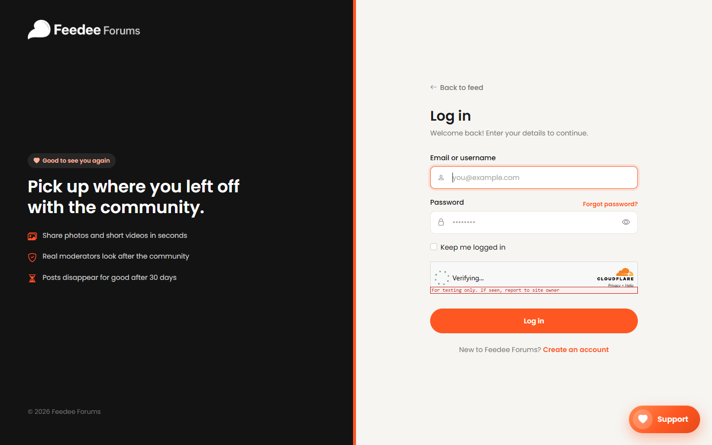
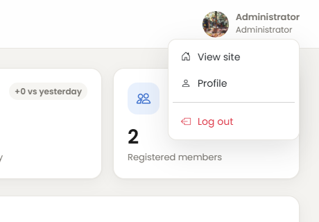
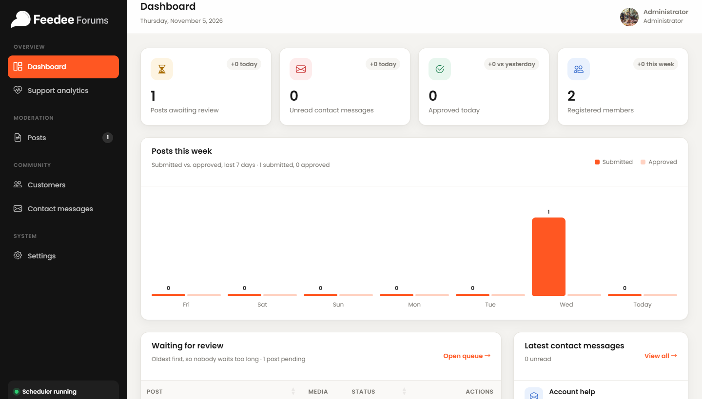
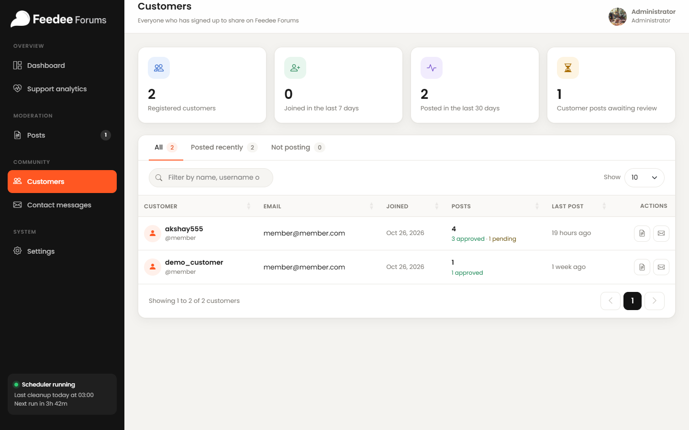
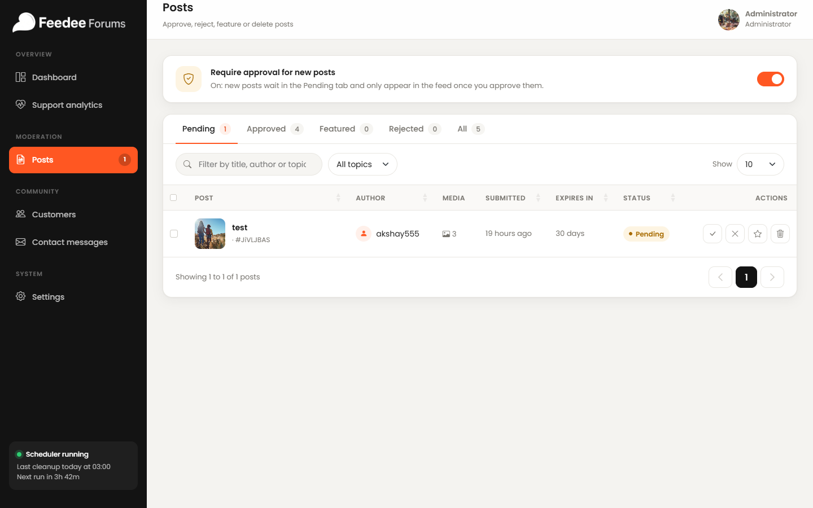
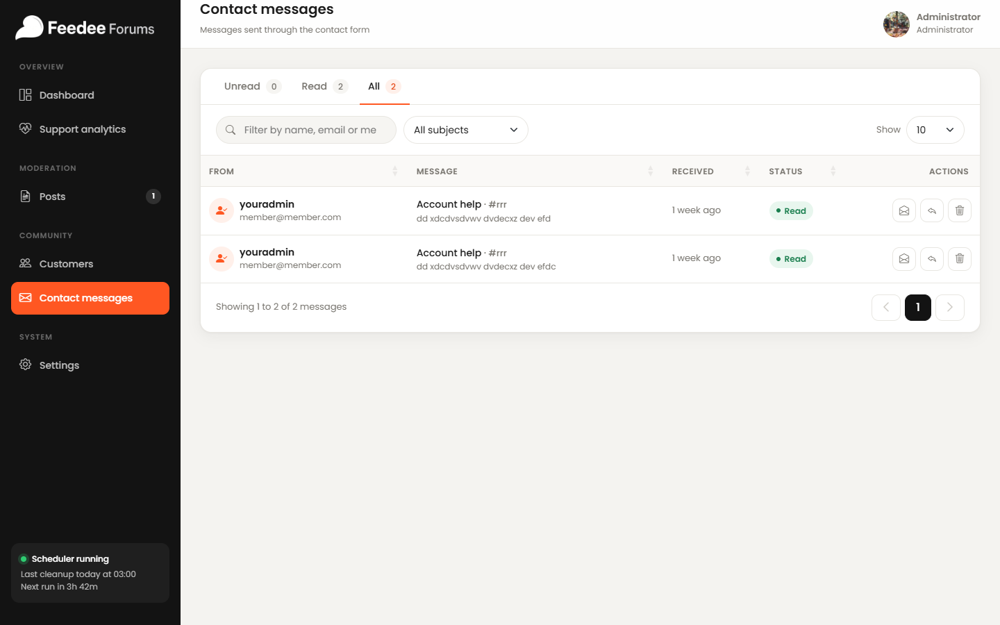
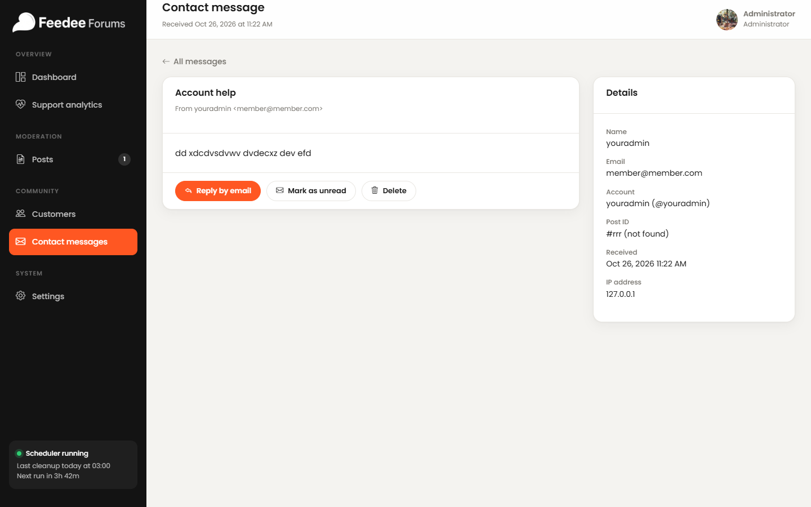
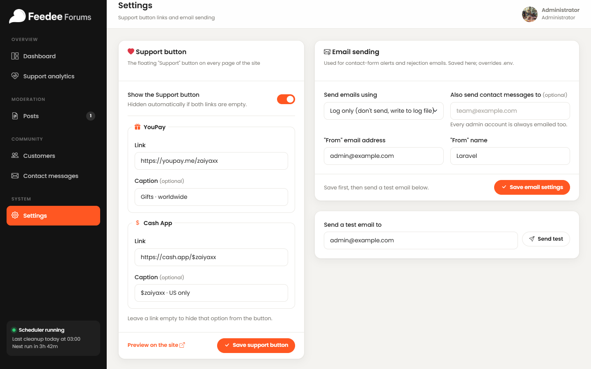
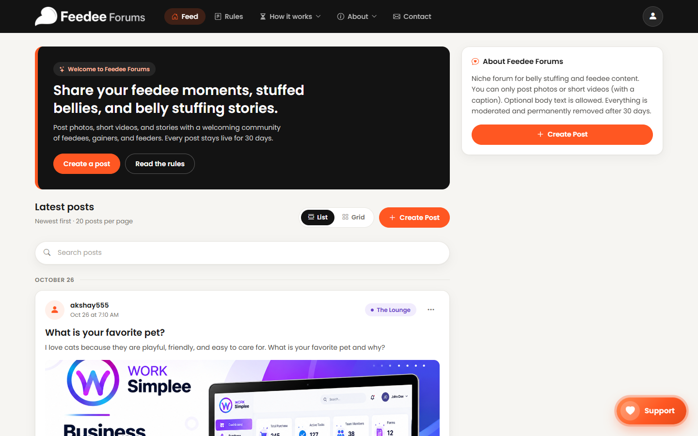
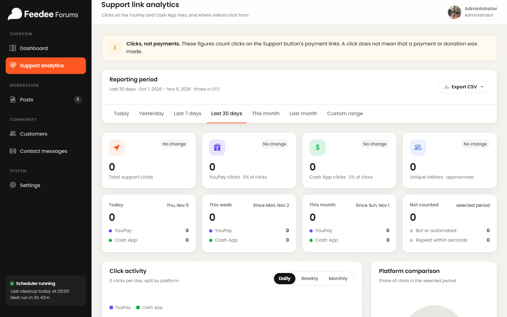

# Feedee Forums — Admin Panel User Guide

**Website:** https://feedeeforums.com/  
**Audience:** Site administrators / client operators  
**Version:** 1.0 — November 2026  
**PDF:** `docs/Feedee-Forums-Admin-User-Guide.pdf`  
**Screenshots:** `docs/admin-guide/screenshots/`

This document is the editable source for the client-ready PDF. It describes only features that exist in the current Laravel application.

---

## Table of contents

1. Introduction  
2. Admin login  
3. Dashboard  
4. Customer management  
5. Post management  
6. Contact messages  
7. Website settings  
8. Support button & analytics  
9. Other admin features  
10. Security best practices  
11. Troubleshooting & FAQ  
- Appendix A — Feature summary  
- Appendix B — Unavailable / incomplete features  

---

## 1. Introduction

The Feedee Forums admin panel is the control centre for running the community website. Administrators use it to moderate posts, review member activity, respond to contact enquiries, configure the public Support button, monitor support-link clicks, and manage email delivery settings.

### Purpose

- Keep the public feed safe, friendly, and on-topic  
- Approve, reject, feature, or permanently delete posts and media  
- Monitor registered customers and posting activity  
- Read and manage contact-form messages  
- Control Support payment links and review click analytics  
- Configure outbound email for rejection notices and contact alerts  

### Access model

Only accounts with the **admin** role can open `/admin`. After login, admins are redirected to the admin dashboard. The sidebar provides navigation between all working admin sections.

---

## 2. Admin login

### Access

1. Open https://feedeeforums.com/login  
2. Sign in with an administrator email/username and password  
3. Admin users are redirected to `/admin`  
4. Visiting `/admin` directly while logged out redirects to login  



### Security recommendations

- Use a unique, strong password  
- Avoid “Keep me logged in” on shared computers  
- Never share admin credentials in chat, email, or screenshots  
- Use **Forgot password?** if needed  

### Log out

1. Open the administrator menu (top right)  
2. Choose **Log out**  



---

## 3. Dashboard



### Summary cards

| Card | Meaning |
| --- | --- |
| Posts awaiting review | Pending posts; opens Posts |
| Unread contact messages | Unopened contact messages; opens Contacts |
| Approved today | Approvals today vs yesterday |
| Registered members | Customer accounts + joins this week |

### Other dashboard areas

- **Posts this week** — submitted vs approved for the last 7 days  
- **Waiting for review** — oldest pending posts with quick actions  
- **Latest contact messages** — newest enquiries  
- **Support analytics strip** — recent Support activity + link to full report  
- Sidebar scheduler indicator — important for 30-day cleanup  

---

## 4. Customer management



### What you can do

- View all registered customers (non-admin members)  
- See joins this week, active posters (last 30 days), and pending customer posts  
- Filter tabs: All / Posted recently / Not posting  
- Search by name, username, or email  
- View a customer’s posts (opens Posts filtered by name)  
- Email a customer via mailto  

### Not available

Edit, ban, suspend, delete-account, and role-change actions are **not** implemented on this page.

---

## 5. Post management



### Require approval switch

- **Off:** new posts go live immediately; you can still moderate later  
- **On:** new posts start as Pending and stay hidden until approved  

### Status tabs

Pending · Approved · Featured · Rejected · All

### Actions

| Action | Result |
| --- | --- |
| Approve | Publishes to the feed; starts 30-day lifetime |
| Reject | Requires reason; author is emailed; removed from feed if live |
| Feature | Pins in Featured (also approves if pending) |
| Delete | Permanently removes post + all media after confirmation |
| Bulk bar | Approve / Feature / Reject / Delete multiple selected posts |

### Media

- Rows show photo/video counts and thumbnails  
- Click the title to preview the public post before approving  
- Delete removes originals and thumbnails forever  

### 30-day automatic removal

Approved posts expire 30 days after going live. Cleanup runs through the Laravel scheduler (server cron must call `php artisan schedule:run` every minute).

---

## 6. Contact messages



### Inbox

- Tabs: Unread / Read / All  
- Search by name, email, or message  
- Filter by subject  

### Detail page



Opening a message marks it read. You can:

- Reply by email (mailto)  
- Mark as unread  
- Delete permanently  

Details include sender, linked account (if any), post reference, received time, and IP address.

---

## 7. Website settings



### Support button

| Setting | Public effect |
| --- | --- |
| Show the Support button | Site-wide floating button on/off |
| YouPay link + caption | First support option |
| Cash App link + caption | Second support option |

Empty links hide that option. If both are empty, the button is hidden automatically.

### Email sending

- Mailer: Log only or SMTP  
- Optional extra contact recipient (admins always receive contact alerts)  
- SMTP host/port/encryption/username/password  
- From address / From name  
- Save, then send a test email  

---

## 8. Support button & analytics

### Public Support button



When enabled, visitors can open YouPay / Cash App from the floating Support dial.

### Analytics



Implemented analytics:

- Periods: Today, Last 7 days, Last 30 days, This month, Custom  
- Totals: clicks, YouPay, Cash App, approximate unique visitors  
- Country breakdown (needs GeoIP import)  
- Daily stats and recent activity  
- CSV export: countries, daily statistics, every click  

**Important:** figures are clicks, not completed payments.

---

## 9. Other admin features

- **`/admin/docs`** — in-app HTML moderation guide (route works; not linked in sidebar)  
- **Profile** — update the logged-in admin account/password  
- **View site** — open the public feed  
- **Scheduler indicator** — sidebar status for cleanup jobs  

---

## 10. Security best practices

- Protect admin credentials; use a password manager  
- Use strong passwords; rotate if a device is lost  
- Log out after admin work on shared devices  
- Do not share one admin account across many people  
- Treat deletes as irreversible  
- Keep contact emails/IPs private  
- Test SMTP before relying on rejection/contact emails  

---

## 11. Troubleshooting & FAQ

**Cannot open /admin**  
Confirm the account has the admin role; log in at `/login` first.

**Pending posts not in the feed**  
If approval is required, approve them under Posts → Pending.

**Missing images/videos**  
Confirm the post still exists and has not expired/deleted; check storage configuration on the server.

**No contact emails arriving**  
Check Settings → Email sending, send a test, and remember “Log only” writes to the app log. Messages still appear in Contact messages.

**Dashboard counts look odd**  
Cards reflect live DB counts; refresh after moderating.

**Countries show Unknown**  
Import/update the GeoIP database on the server and keep the scheduler running.

---

## Appendix A — Feature summary

| Feature | Status | Notes |
| --- | --- | --- |
| Admin login / logout | Working | Role-gated `/admin` |
| Dashboard stats & chart | Working | Pending, messages, approvals, members |
| Post moderation | Working | Approve, reject, feature, delete, bulk |
| Post approval switch | Working | On Posts page |
| Customer list | Working | Search/filter; view posts; mailto |
| Contact inbox | Working | Read/unread, reply, delete |
| Support button settings | Working | YouPay + Cash App |
| Mail settings + test | Working | Log or SMTP |
| Support link analytics | Working | Ranges, platforms, CSV export |
| 30-day auto deletion | Working | Requires server scheduler/cron |
| In-app `/admin/docs` | Working | Not in sidebar |

---

## Appendix B — Unavailable or incomplete features

| Item | Why excluded / limited |
| --- | --- |
| Admin Reports UI (`/admin/reports`) | Static mock with hard-coded sample stats; no working reports backend |
| Customer edit / ban / delete | Not implemented |
| Assign staff roles from UI | No promote/demote UI |
| In-panel contact reply composer | Mailto only |
| Sidebar link to `/admin/docs` | Route works; not listed in sidebar |

---

## Rebuild notes (maintainers)

Screenshots and PDF can be regenerated locally:

```bash
cd docs/admin-guide/build
node capture.mjs
node make-pdf.mjs
```

Output PDF path: `docs/Feedee-Forums-Admin-User-Guide.pdf`
